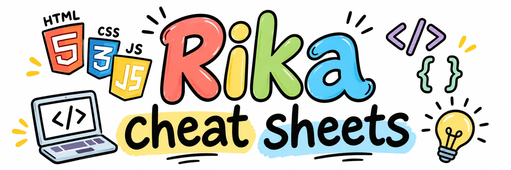

# Rika cheat sheets



Kézzel rajzolt frontend puskák, újrahasznosítható JavaScript snippetek és egy pipálható tanulási roadmap.
*Hand-drawn frontend cheat sheets, reusable JavaScript snippets and a learning roadmap you can tick off.*

> A gyűjteményt még noob koromban kezdtem: ami megtetszett vagy amit végre megértettem, azt ide írtam fel.
> Azóta nő, és lassan saját oldal lett belőle.
>
> *I started collecting these back in my noob days: whatever I liked or finally understood went in here.
> It kept growing, and slowly turned into a site of its own.*

**Élő oldal / Live:** https://mazsola739.github.io/rika-cheat-sheets/

| Oldal | Mit tud |
| --- | --- |
| [Roadmap](roadmap.html) | Az én utam frontendtől fullstackig: HTML, CSS, JavaScript → TypeScript → React, kitérők (Next.js, Angular), aztán Node.js és Express. 5 szakasz, 145 pont. Pipálás, a haladás a böngészőben marad; oldalt egy kicsinyített térképen látszik, mennyire színesedett ki. Letöltés képként (`.png`), checklistként (`.md`), mentésként (`.json`), és visszatöltés. |
| [Cheat sheetek](cheatsheets.html) | 19 puska blueprint stílusban (Flexbox, Grid, CSS szelektorok, színek & háttér, színátmenet, árnyékok, keret, gomb, JS alapok, stringek, számok & dátumok, tömbmetódusok, regex, hibák & JSON, globális függvények, async, DOM, Git, React hookok). Ahol lehet kattintgatni, fent egy világos „poszter”: Flexbox / Grid játszótér vagy CSS-generátor (színválasztó, gradiens, árnyék, keret, gomb) élő előnézettel és másolható CSS-sel; alatta a lista. Kattintásra másolás, nyomtatás. |
| [Snippetek](snippets.html) | 167 JavaScript snippet kartotékkártyákon egy kartondobozban (vagy kódablakokban); a kártya elején a kód, megfordítva hátul a példa: kategóriafülek, a „Mind” fülön kategóriánként csoportosítva, oldalanként 10 (lapozóval), keresés (`/`), kedvencek, másolás. A ▶ Futtatás gomb a böngészőben (külön Web Workerben) lefuttatja a példát, és mutatja az eredményt, egyezésnél zöld pipával; a kód és a példa a kártyán át is írható (Ctrl+Enter futtatja). |
| [Elvek](principles.html) | 50 fejlesztési alapelv nyolc csoportban (alapelvek, gondolkodás és hibakeresés, munkamódszer, értékek, SOLID, tervezés, frontend, törvények – pl. KISS, DRY, YAGNI, Early Return, Rubber Duck, Tell Don’t Ask, Murphy) katalógusban, néhány ötlet a [DevIQ](https://deviq.com/principles/) listáiból, saját szöveggel és képekkel, a [refactoring.guru](https://refactoring.guru/) elrendezésének mintájára: oldalsáv fa-menüvel, ByteByteGo-stílusú szivárványkerék számozott csoportdobozokkal (rámutatásra kigyullad a szelet, a nyila és a neve a listában), képes csempék. Minden elvhez saját plakát-mém, probléma és megoldás kóddal, hasonlat, mikor használd, előnyök és hátrányok, kapcsolódó elvek. |

Minden oldal magyarul és angolul is olvasható (HU / EN kapcsoló a menüben).

## Helyi futtatás

Nincs build lépés, sima HTML + CSS + JavaScript. A snippet-oldal `fetch`-csel tölti be a forrást, ezért
egy kis webszerver kell (a fájl dupla kattintással megnyitva nem működik):

```bash
python -m http.server 5500
```

Aztán: http://localhost:5500

## Szerkezet

```
index.html            kezdőlap
roadmap.html          pipálható roadmap
cheatsheets.html      cheat sheetek (#flexbox, #grid, …)
snippets.html         snippetek
principles.html       elvek (KISS, YAGNI, SOLID…)
404.html
assets/
  css/                base.css (közös) + oldalankénti stílus
  js/                 common.js (közös: nyelv, illusztráció, kódkiemelés, másolás)
                      roadmap-data.js, cheatsheets-data.js, principles-data.js  ← a tartalom
                      principles-scenes.js  ← a plakát-mémek saját rajzai (SVG)
  img/                ide jöhet egy saját agy-kép (lásd ott a README-t)
snippets/
  snippets.js         ← a snippetek forrása, ezt olvassa az oldal
  *.js, array/*.js    a régi, külön fájlokba szedett snippetek
```

## Új tartalom hozzáadása

**Snippet:** írd a `snippets/snippets.js` végére (a `//Synopsis` sor elé), ugyanabban a formában:

```js
/*128. myFunction #array

Rövid leírás, akár több bekezdésben.*/

const myFunction = arr => arr.filter(Boolean);

//myFunction([0, 1, false, 2]); // [1, 2]
```

A `#kategória` lehet: `array`, `string`, `number`, `date`, `dom`, `object`, `function`, `type`, `node`.
A végén lévő `//` sorokból lesz a „Példa” blokk.

**Cheat sheet:** új objektum az `assets/js/cheatsheets-data.js` tömbjébe. Egy sor: `['kód', { hu: '…', en: '…' }]`.

**Elv:** új kártya az `assets/js/principles-data.js` `cards` tömbjébe (`big`, `name`, `group`, `summary`, `why`, `bad`, `good`, `watch`). Ugyanazzal az `id`-vel jöhet a hosszabb leírás a `guide` listába (`problem`, `analogy`, `when`, `pros`, `cons`, `related`), a plakát szövege a `posters` listába (`title`, `caption`), a csoporton belüli helye az `order` listába, a kép pedig az `assets/js/principles-scenes.js`-be (egy függvény, ami 400 × 300-as SVG-t ad vissza).

**Roadmap pont:** `assets/js/roadmap-data.js`. Egy pont: `['kulcs', 'magyar', 'english', 'good']`.
A kulcsot ne nevezd át később, mert ahhoz kötődik a mentett pipa.

## Tervben

- **Tervezési minták** (design patterns) cheat sheet, a [refactoring.guru](https://refactoring.guru/design-patterns)
  alapján, pl. [Factory Method](https://refactoring.guru/design-patterns/factory-method). A részleteket még kifejtem.

## Közzététel (GitHub Pages)

Settings → Pages → *Deploy from a branch* → `main` / `(root)`. A `.nojekyll` fájl miatt a GitHub
nem futtat rajta Jekyllt, a fájlok úgy mennek ki, ahogy vannak.

## Forrás és licenc

Az 1–127. snippet a [30 seconds of code](https://www.30secondsofcode.org/) projektből származik
([CC BY 4.0](https://creativecommons.org/licenses/by/4.0/)), Fatos Morina gyűjtésén keresztül.
A 128–167. snippet ehhez az oldalhoz készült.
Betűtípusok: [Patrick Hand](https://fonts.google.com/specimen/Patrick+Hand) és
[Shantell Sans](https://fonts.google.com/specimen/Shantell+Sans) (Google Fonts, OFL).
Az agy és a logó képe (`assets/img/`) AI-val készült, rájuk nem vonatkozik szabad licenc.
